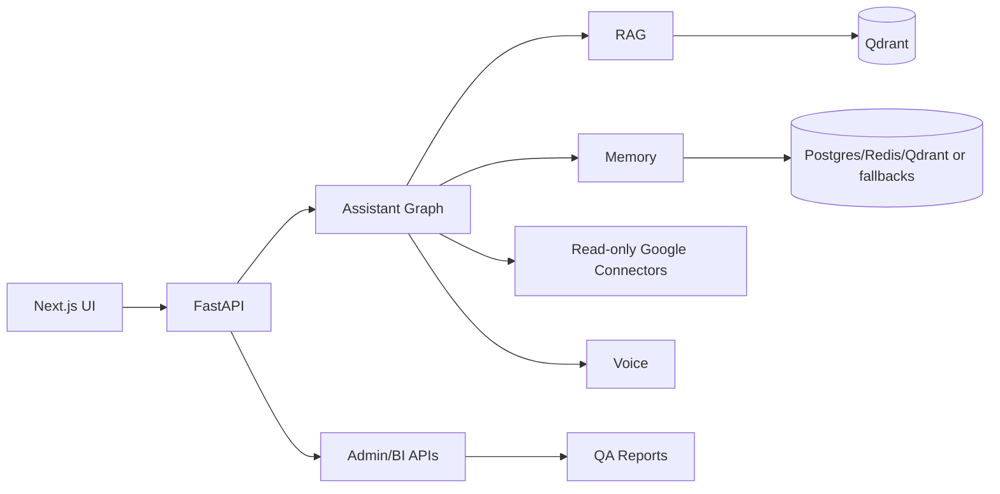

# OmniAssistant HUS

Enterprise-style AI assistant platform for VNU University of Science. The project demonstrates a complete Data Mining / AI Systems architecture with Data Layer, AI Module, BA & QA/QC, and CMS/BI Dashboard.

## Features

- Institutional RAG over HUS web pages, admissions pages, and curriculum PDFs.
- Raw/processed/features data lake.
- Qdrant semantic retrieval with local fallback.
- FastAPI backend.
- Next.js frontend.
- Assistant orchestration for RAG, memory, tasks, Gmail summary, Calendar today, daily briefing, and fallback.
- Personal memory and task memory.
- Read-only Gmail and Google Calendar mock/OAuth-ready connectors.
- Push-to-talk voice API and frontend microphone button.
- QA reports for data quality, retrieval, groundedness, and API contracts.
- Admin CMS and BI dashboard.

## Architecture



Detailed diagrams are in `docs/report/architecture.md`.

## Tech Stack

- Python 3.10
- FastAPI
- Qdrant / local Qdrant
- sentence-transformers
- faster-whisper
- optional edge-tts
- PostgreSQL / Redis with local fallbacks
- Next.js, TypeScript, Tailwind
- pytest

## Setup

```powershell
cd D:\OmniAssistant_Workspace\project-root
python -m pip install -e ".[features,parsing,storage,dev]"
copy .env.example .env
```

Frontend:

```powershell
cd frontend
npm.cmd install
copy .env.example .env.local
```

Optional services:

```powershell
docker compose up -d db redis qdrant
```

## Run

Backend:

```powershell
cd D:\OmniAssistant_Workspace\project-root
python scripts/run_backend.py
```

Frontend:

```powershell
cd D:\OmniAssistant_Workspace\project-root\frontend
npm.cmd run dev
```

Open:

```text
http://localhost:3000
```

## Data Pipeline Commands

```powershell
python scripts/run_seed_crawl.py --depth 1 --max-pages 20
python scripts/run_parse_raw.py --limit 50
python scripts/run_build_features.py --latest --chunk-size 800 --chunk-overlap 120
python scripts/run_index_qdrant.py --latest --collection omni_hus_chunks --batch-size 32
```

## Backend APIs

- `GET /health`
- `POST /api/rag/query`
- `POST /api/assistant/chat`
- `POST /api/memory/remember`
- `GET /api/memory/summary`
- `GET /api/tasks`
- `POST /api/google/gmail/sync`
- `POST /api/google/calendar/sync`
- `GET /api/assistant/daily-briefing`
- `POST /api/voice/chat`
- `GET /api/admin/documents`
- `GET /api/admin/feature-summary`
- `GET /api/admin/qa-reports`

## QA Commands

```powershell
python -m pytest qa_ba/api_tests -q
python scripts/run_data_quality.py
python scripts/run_retrieval_eval.py
python scripts/run_rag_eval.py
npm.cmd run build
```

## Report Package

See `docs/report/`:

- `final_report.md`
- `architecture.md`
- `data_layer.md`
- `ai_module.md`
- `ba_qa_qc.md`
- `cms_bi.md`
- `demo_script.md`
- `grading_checklist.md`

## Limitations

- No email sending.
- No calendar create/update/delete actions.
- No production auth.
- No full realtime duplex voice.
- Current institutional dataset is a cold-start demo dataset.
- RAG quality depends on source coverage and embedding model availability.
- Google OAuth is read-only and mock mode is default for demo safety.

## Future Work

- Real OAuth token lifecycle and consent UI.
- More HUS source coverage and scheduled refresh jobs.
- Better Vietnamese OCR for scanned PDFs.
- LangGraph dependency swap-in for the current graph-style runner.
- Production auth/RBAC and audit UI.
- Real TTS installation and streaming ASR/TTS.
