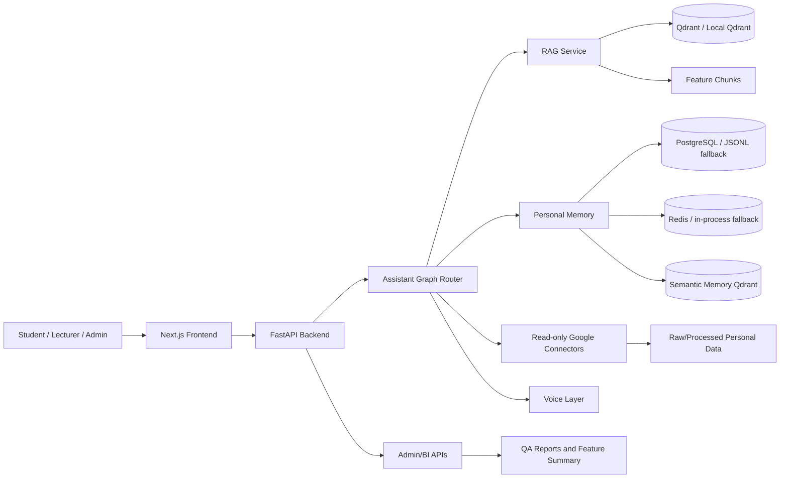
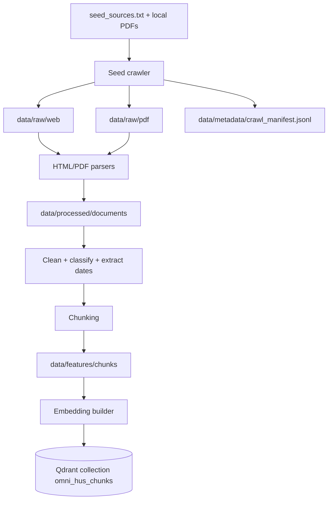
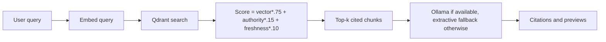
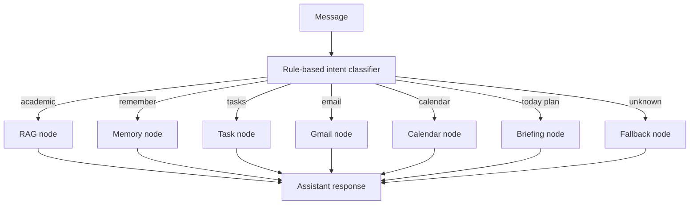
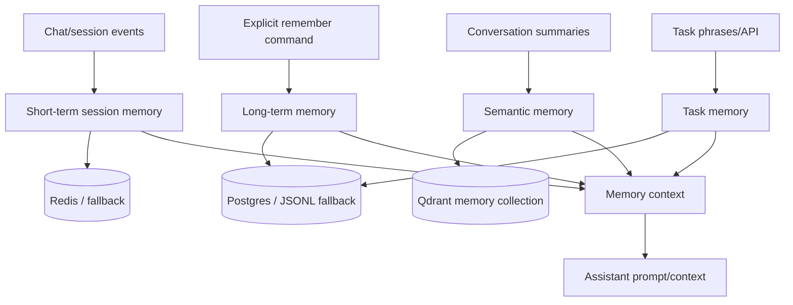

# Architecture

## Overall System Architecture



## Data Pipeline



## RAG Pipeline



## Assistant Orchestration Flow



## Voice Pipeline

```mermaid
flowchart LR
  Mic[Browser MediaRecorder] --> Upload[/api/voice/chat]
  Upload --> ASR[faster-whisper ASR]
  ASR --> Graph[Assistant graph]
  Graph --> TTS[edge-tts or fallback WAV]
  TTS --> Audio[data/generated/audio]
  Audio --> Player[Browser audio player]
```

## Memory Architecture


